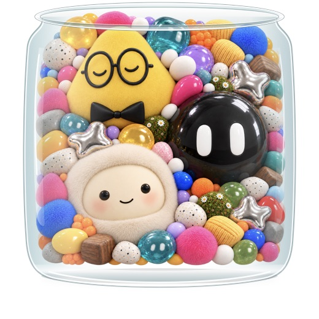

# 宠物罐

一个 macOS 原生桌面宠物项目，把 ChatGPT、Grok Bot 与 Muse 三个角色装进拥挤的透明玻璃罐。点击角色打开对应消息框；hover 只改变眼部表情，身体保持静止。

当前版本：**0.5.3**。Swift / AppKit / SwiftUI，Apple Silicon，macOS 14 或更高版本。



## 开发

需要 Xcode Command Line Tools，无第三方依赖。

```sh
make build   # 构建、签名并执行内置自测
make run     # 构建并打开桌面宠物
make test    # 构建并执行内置自测
make package # 生成 App 与 ZIP
```

也可以直接执行 `bash build.sh`。应用输出到 `dist/宠物罐.app`，安装包输出到 `dist/宠物罐-macOS.zip`，编译临时文件位于 `.build/native/`。构建与打包不依赖原对话的目录结构。

## 源码

| 文件 | 职责 |
| --- | --- |
| `Main.swift` | 应用入口、消息框、独立草稿、窗口和快捷键、自测 |
| `Jar.swift` | 玻璃材质、内壁裁剪、鼠标命中、拖动 |
| `PackedScene.swift` | 静止堆叠、角色轮廓、局部眼部表情 |
| `Delivery.swift` | 客户端路由、辅助功能投递、复制与打开回退 |
| `Resources/` | 角色、堆叠与眼部表情素材 |
| `Materials.swift` | 旧版素材布局，仅保留作参考，不参与构建 |
| `docs/原型说明.md` | 原型能力、验证记录和通信限制 |
| `*-prompt.txt`、`*-prompts.json` | 图像素材生成提示词 |

## 已确定的交互

- 玻璃罐紧贴宠物堆，整堆收在内壁范围内。
- ChatGPT 为黄色圆角三角宠物，戴圆眼镜与黑领结；Grok 为黑色亮球；Muse 为奶油色毛绒角色。
- hover 只做睁眼或眨眼，不抬起、放大或摇晃身体。
- 底部后侧白线不绘制到宠物前方。
- 装饰物不发送消息；三个角色分别保留草稿。

## 客户端通信状态

点击宠物打开对应消息框已实现。复制并打开客户端已验证。直接填入和发送逻辑已实现，但“宠物罐”尚未获得 macOS 辅助功能权限，真实自动发送仍待逐客户端验证。当前需要先在目标客户端选择会话；没有实现自动寻找指定 dot 或把回复读回宠物窗口。

辅助功能设置位于“系统设置 → 隐私与安全性 → 辅助功能”。权限应授予固定位置的 App；移动或重新签名后需重新确认。

## 作为桌面项目使用

在 ChatGPT / Codex 侧栏中添加本项目目录，即可继续开发。当前整理未新建远程仓库，也未上传或发布任何内容。
