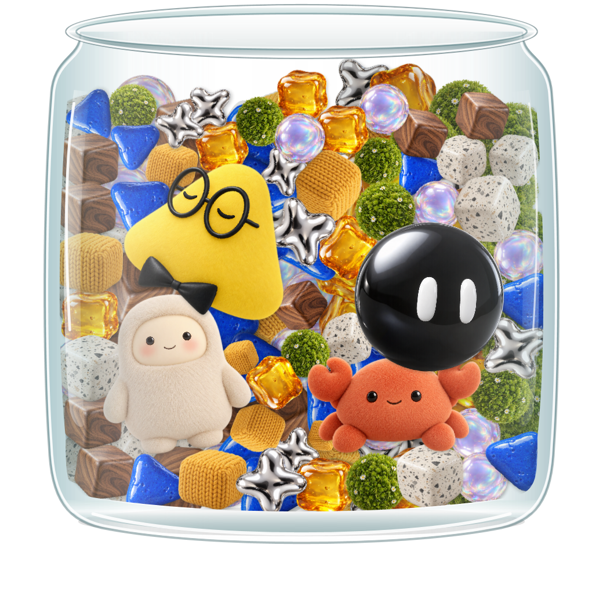

# 宠物罐

macOS / Windows 原生桌面宠物，把 ChatGPT、Grok Bot、Muse 与 Claude 四个角色装进透明玻璃罐。双击宠物打开对应客户端，悬停查看账号用量 / 剩余额度。Windows 中每只宠物和装饰都能轻点推动、拖动、下落和碰撞。

Windows 使用 C# / WPF / Win32，macOS 使用 Swift / AppKit。没有浏览器、WebView 或 Electron。消息输入框、写消息入口与自动投递功能已移除，两端不再注册原消息快捷键。



## Windows 启动与打包

开发需要 .NET 8 或更新的 SDK，在 PowerShell 中运行：

```powershell
./build.ps1 -Run      # 构建、自测、启动原生窗口
./build.ps1 -Package  # 生成自包含 EXE 与 ZIP
```

产物为 `dist/windows-win-x64/PetJar.exe`，压缩包为 `dist/宠物罐-Windows-win-x64.zip`，无需额外安装 .NET。素材嵌入 EXE，运行不依赖项目目录。可用 `-Runtime win-arm64` 指定 ARM64 构建，需在对应设备验收。

## 使用

- Windows 轻点物体可推动，按住拖动可带动周围物体；松手后下落、碰撞并重新堆叠。拖动空白玻璃或罐沿移动整个罐子。主键、次键均可拖动，次键原地点击仍打开菜单。
- 拖着罐子来回晃时，宠物与装饰会因惯性相对偏移、翻滚和碰撞；停下后继续晃动并自然落稳。找回位置和屏幕边缘夹紧不会造成额外冲击。
- 按空隙补入大小不同的小装饰，让罐内更饱满；前后遮挡与轻微接触阴影增加空间感。小填充物同样可点可拖，仍保留自然小缝。
- 前排缝隙由后排物体错开遮挡，减少直接透到桌面的空洞；后排光照更暗，前排接触阴影更清楚。前后两排都有独立物理物体，露出的后排也能抓取，橱窗选择同时影响两排。纵深是 2.5D 近似，罐口保留少量自然留白。
- 单击宠物不打开窗口，双击仅启动或激活对应客户端。装饰物没有客户端路由。
- 悬停查看账号额度并改变眼部表情，不对身体施加运动；眼睛、身体与点击区域随同一个物理姿态移动。碰撞伴随轻微材质压缩 / 回弹，属于刚体物理加视觉形变，并非真实软体网格。
- 毛绒和针织物会沿受力方向轻微压缩、向侧面鼓起，堆叠受压和按住抓取都有柔软反馈，解除后缓慢回弹；金属、石头、木头等保持硬质形状。悬停不触发挤压。
- Windows 右键罐子 →“宠物橱窗”展示全部四只 AI 宠物。点击卡片立即放入罐中，再点一次移回，每种最多一只。状态自动保存，关闭橱窗和重启后保留；移回不清除客户端绑定或额度来源。
- Windows 右键罐子 →“填充物橱窗”可多选木纹、晶块、针织、镜面星星、琥珀、苔藓、石纹与泡泡。点击卡片立即切换填充，再点取消，无需确认。选一种就只用该种重复填充，选多种则均匀混合；全选 / 清空立即生效，选择自动保存。托盘也提供入口。
- Windows 右键罐子 → 角色 →“绑定客户端 / 额度来源…”可选择本地程序或已打开的窗口，并指定额度来源。
- 右键“重新识别本机客户端”重新扫描安装记录。“找回宠物罐”恢复可见位置。托盘提供橱窗、找回和退出，双击托盘打开橱窗。

Windows 核对安装记录、产品 / 发布者身份和已注册 Store 应用。ChatGPT 对应 OpenAI Codex 桌面版，Grok 对应 Grok Bot，Claude 对应 Anthropic Claude。CLI、Cursor 或其他厂商同名软件不会仅因名称相同而绑定；未识别或有歧义时手动选择。有效手动绑定保留，自动管理的 Store 应用升级后刷新路径并保留 AUMID。

位置、罐内成员、绑定和额度来源保存在 `%LOCALAPPDATA%/PetJar/settings.json`。旧配置中的会话标题筛选不再使用。程序不再操作消息编辑器、剪贴板或客户端发送按钮。

## 账号用量 / 剩余额度

Windows 悬停面板采用与菜单一致的乳白材质卡片，每 45 秒刷新，只显示登录来源、周期、剩余百分比、重置时间和更新时间。未知不记为 0，不将本机 Token 累计当作账号额度；失败显示简短原因，有旧结果时标明刷新失败和上次读取，过期周期不再显示旧百分比。单击与浮层不会打开客户端，鼠标打开只由罐内宠物双击触发；右键菜单仍提供显式“打开客户端”操作。

ChatGPT 默认读取本机 Codex CLI 登录账号的 `account/rateLimits/read`，表示 Codex 订阅额度。Claude 默认只读本机 Claude Code OAuth 登录，通过兼容额度端点读取；该端点没有稳定公开 API 保证，登录无效或读取失败时不可获取，不自动刷新凭据或更改登录。Grok / Muse 暂未接入真实账号额度。

自动来源只与明确识别的绑定程序匹配，也可显式选择。用户需确认 CLI 与桌面客户端使用同一账号。凭据不写入设置或报告，读取不创建模型会话、不消费额度重置。

诊断：`PetJar.exe --quota-report <json路径>`、`PetJar.exe --discover-clients <json路径>`。

## macOS 构建

需要 Xcode Command Line Tools，面向 Apple Silicon、macOS 14+：

```sh
make build
make run
make test
make package
```

也可运行 `bash build.sh`。App 为 `dist/宠物罐.app`，压缩包为 `dist/宠物罐-macOS.zip`。macOS 保留双击打开、悬停额度和拖动罐子，右键菜单提供各客户端入口。Windows 宠物橱窗与独立物体物理场景尚未移植到 macOS。当前 Windows 环境无法编译或运行 macOS，源码变更需在 Mac 上验收。

## 源码与验证

| 文件 | 职责 |
| --- | --- |
| `Windows/Program.cs`、`PetWindow.cs` | Windows 入口、窗口与客户端交互 |
| `Windows/PetShowcaseWindow.cs` | 宠物橱窗、选择与添加 |
| `Windows/JarPhysicsScene.cs`、`JarMotion.cs`、`PhysicsJarDrawing.cs` | 独立物体、重力 / 碰撞 / 抓取、整罐惯性、原生绘制与随动眼睛 |
| `Windows/MaterialSquash.cs` | 毛绒 / 针织方向性受压、轻握与阻尼回弹，硬质保持刚性 |
| `Windows/BindingWindow.cs`、`ClientDiscovery.cs`、`ClientLauncher.cs` | 绑定、识别与激活 |
| `Windows/DesktopTheme.cs`、`JarMenu.xaml` | 共享窗口和菜单样式 |
| `Windows/Model.cs`、`JarDrawing.cs`、`EyeExpression.cs` | 设置、成员、场景与眼部动画 |
| `Main.swift`、`Clients.swift` | macOS 入口与客户端身份 |
| `Jar.swift`、`PackedScene.swift` | macOS 玻璃、堆叠、命中与表情 |
| `AccountUsage.swift` | macOS 只读账号额度 |
| `Resources/` | 项目内角色、堆叠与眼部素材 |

玻璃、内壁裁剪、角色命中与眼部共用场景坐标。Windows 构建校验两端几何并执行原生像素与交互自测。`dist/`、`.build/` 不入 Git。外观验收区分离屏与实际窗口，详见 [Windows 适配说明](docs/Windows适配.md)。

Windows 使用固定版本的纯托管 `Box2D.NetStandard 2.4.7-alpha`，以 120Hz 固定步长求解。第三方许可随 EXE / ZIP 分发，见 [THIRD-PARTY-NOTICES.txt](THIRD-PARTY-NOTICES.txt)。物体位置每次启动重新自然堆叠；橱窗成员、客户端绑定与额度来源继续保存。
