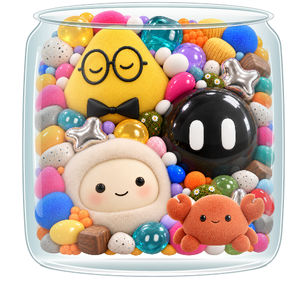

# 宠物罐

一个 macOS / Windows 原生桌面宠物项目，把 ChatGPT、Grok Bot、Muse 与 Claude 四个角色装进拥挤的透明玻璃罐。双击宠物打开对应客户端，悬停查看账号用量 / 剩余额度；身体保持静止，表情变化仅限眼部。Windows 使用 WPF / Win32，无浏览器、WebView 或 Electron。

当前版本：**0.5.3**。macOS 使用 Swift / AppKit / SwiftUI（Apple Silicon，macOS 14+）；Windows 使用 C# / WPF（Windows 10/11，默认 x64）。



## Windows 启动与打包

开发需要 .NET 8 或更新的 SDK。在 PowerShell 中执行：

```powershell
./build.ps1 -Run          # 构建、自测、启动原生透明窗口
./build.ps1 -Package      # 生成自包含 EXE 与 ZIP，无需另装 .NET 运行时
./build.ps1 -DeliveryTest # 点击弹出的测试按钮，再向临时本地 WPF 窗口验证投递保护
```

输出为 `dist/windows-win-x64/PetJar.exe`，安装包为 `dist/宠物罐-Windows-win-x64.zip`。直接双击 EXE 即可运行。素材嵌入 EXE，移动产物无需携带项目或原对话目录。首次启动会展开自带运行时，不需管理员权限。可用 `-Runtime win-arm64` 指定 ARM64 构建；需在对应设备上验收。投递测试需要点击本地测试按钮，让 Windows 确认前台输入来自此进程；仅操作临时测试窗口，不向真实客户端发送。

Claude 是罐子右下方的暖橘色小螃蟹，可独立双击打开客户端、保留草稿、设置投递方式和绑定 Windows 客户端。Windows 启动时会自动识别并绑定本机已安装的对应程序；无法识别时，双击打开手动绑定窗口。也可右键罐子选择对应角色 →“绑定客户端 / 额度来源…”。透明素材为项目生成插画，见 `Resources/pet-claude.png`；原始提示词见 [Claude 素材提示词](claude-character-prompt.txt)。Windows 四角色构建与原生窗口已验收；macOS 已同步源码和本地资源，当前 Windows 环境未编译或运行 macOS 版本。

单击宠物不弹出对话框；双击仅启动或激活客户端，不复制文字、填入草稿或发送消息，拖动不会触发打开。需要写消息时，右键罐子选择对应角色 →“写消息…”，或按 Alt+Space 呼出上次角色。磨砂输入框的头像居中跨在左上方的上沿，内外各占一半；发送按钮位于右下角，右上角 × 关闭对话框并保留本次草稿。右键头像或输入框可设置投递方式并查看最近结果；点击发送不代表服务端接收。Windows 11 22H2 及以上使用原生背景模糊，不支持时回退到系统 Acrylic 或浅色表面。

窗口沿罐子侧面定位，切换宠物或拖动罐子时同步更新。Windows 四只宠物在待机时错开眨眼，黄色宠物偶尔缓缓睁眼再休息；悬停时睁眼回应、轻眨或眨单眼，聊天时双眨并持续保持眼部活动。鼠标移开、切换角色和关闭对话框均平滑过渡，关闭后回到待机。眨眼采用单个眼形的压缩 / 展开，固定局部材质遮住原眼睛，避免睁眼和闭眼半透明叠加产生残影。动画跟随 WPF 合成帧，只更新独立眼部图层，静态堆叠和玻璃不逐帧重绘；系统关闭客户区动画时使用静态表情。双击角色打开客户端；拖动罐子移动；Esc 收起；Alt+Space 呼出上次角色；Ctrl+Enter 投递。右键菜单与系统托盘可打开对话、找回位置和退出。快捷键冲突时仍可通过宠物或托盘操作。悬停只改变眼部，不移动、缩放或摇晃身体。

Windows 在后台检查已安装程序记录、应用目录和已注册应用包，并核对可执行文件的产品 / 发布者信息；仅自动绑定明确识别的客户端。ChatGPT 角色对应 OpenAI Codex 桌面版，Claude 对应 Anthropic Claude，Grok 对应 Grok Bot。CLI、Cursor 或其他厂商同名 Muse 不会误绑。已存在的有效手动绑定保留；程序管理的自动绑定会在应用升级后更新路径，Store 应用保留注册身份用于启动。右键“重新识别本机客户端”可以重新扫描，未识别的角色仍可手动选择 `.exe` 或已打开窗口。可设置“窗口标题包含”以区分投递时同一应用的多个窗口；双击打开客户端使用该程序的前台窗口，不依赖会话标题。目标会话仍由用户在客户端选择，不提供可靠的智能体 / 会话身份绑定。

## 账号用量 / 剩余额度

悬停面板显示真实账号额度的已用 / 剩余百分比、周期和重置时间，每 45 秒刷新。未提供总 Token 数时不会换算或编造 Token 数量。读取失败显示不可获取；有旧结果时标明上次读取时间，已经到期的周期不再显示旧百分比。鼠标移出即收起，读取过程在后台执行。

ChatGPT 角色默认读取本机 Codex CLI 登录账号的 `account/rateLimits/read`，优先使用多额度桶，周期由服务器返回值决定，详见 [Codex App Server 文档](https://learn.chatgpt.com/docs/app-server)。这表示 Codex 订阅额度，不能代表其他 ChatGPT 应用或 API 账单。Claude 默认只读本机 Claude Code OAuth 登录信息，通过 Claude Code 兼容额度端点读取；该端点没有稳定公开 API 保证，登录过期、权限不足或系统钥匙串中不可读取的登录均显示不可获取，不自动刷新凭据或更改登录。Claude 的使用口径可在官方 [`/usage` 命令说明](https://code.claude.com/docs/en/commands)中核对。

Windows 自动模式只为绑定为 Codex / Claude 的程序匹配相应来源；其他程序显示不可获取，可在绑定窗口显式选择来源。请确认本机 CLI 与所绑定桌面客户端使用同一账号。Grok / Muse 尚未接入真实账号额度，显示“暂不可获取”，缺失数据不记为 0。读取过程不创建会话、不请求模型、不消费重置，不在设置或日志中保存凭据。可运行 `PetJar.exe --quota-report <json路径>` 导出不含凭据的额度诊断。

默认“复制并打开”会复制文字并尝试唤起绑定窗口。可选择“填入当前会话”或“填入并发送”：仅在唯一识别出可读写的消息输入框、目标草稿为空、前台窗口与焦点确认后粘贴；回读一致才继续找邻近且唯一的发送按钮。不盲按回车，不覆盖非空草稿，不自动重试。不支持 UI Automation ValuePattern 的客户端会停止自动填入，仍可手动粘贴。运行于更高权限的客户端可能无法自动操作，不会自行提权。

界面分别报告复制、打开、填入和点击发送；**点击发送不等于服务端接收**，回复仍在原客户端显示。ChatGPT 的新草稿模式把 `codex://new?prompt=...` 作为参数交给已绑定客户端，请在客户端确认其支持该入口和文字内容。

四个角色的草稿和投递模式在当前运行期间独立保留，投递期间锁定目标与编辑；源草稿不自动清空。窗口位置与客户端绑定保存在 `%LOCALAPPDATA%/PetJar/settings.json`，消息正文不落盘。复制会修改系统剪贴板。

Windows 实现位于 `Windows/`。玻璃、内壁遮罩与原版使用相同变换；`Windows/SceneLayout.json` 沿用 Swift 的角色轮廓和眼部矩形，坐标从左下原点转为左上原点。构建脚本检查原版布局与 Windows 布局一致；素材直接复用 `Resources/`。详细验收范围见 [Windows 适配说明](docs/Windows适配.md)。

## macOS 开发

需要 Xcode Command Line Tools，无第三方依赖。

```sh
make build   # 构建、签名并执行内置自测
make run     # 构建并打开桌面宠物
make test    # 构建并执行内置自测
make package # 生成 App 与 ZIP
```

也可以直接执行 `bash build.sh`。应用输出到 `dist/宠物罐.app`，安装包输出到 `dist/宠物罐-macOS.zip`，编译临时文件位于 `.build/native/`。构建与打包不依赖原对话的目录结构。

## 源码

| 文件 | 职责 |
| --- | --- |
| `Main.swift` | 应用入口、消息框、独立草稿、窗口和快捷键、自测 |
| `Jar.swift` | 玻璃材质、内壁裁剪、鼠标命中、拖动 |
| `PackedScene.swift` | 静止堆叠、角色轮廓、局部眼部表情 |
| `Delivery.swift` | 客户端路由、辅助功能投递、复制与打开回退 |
| `AccountUsage.swift` | macOS 后台只读账号额度、缓存与不可用状态 |
| `Resources/` | 角色、堆叠与眼部表情素材 |
| `Materials.swift` | 旧版素材布局，仅保留作参考，不参与构建 |
| `docs/原型说明.md` | 原型能力、验证记录和通信限制 |
| `*-prompt.txt`、`*-prompts.json` | 图像素材生成提示词 |

## 已确定的交互

- 玻璃罐紧贴宠物堆，整堆收在内壁范围内。
- ChatGPT 为黄色圆角三角宠物，戴圆眼镜与黑领结；Grok 为黑色亮球；Muse 为奶油色毛绒角色；Claude 为暖橘色毛绒小螃蟹，位于罐内右下方。
- 双击打开对应客户端；单击不弹出对话。悬停显示账号额度并改变眼部表情，不抬起、放大或摇晃身体。
- 底部后侧白线不绘制到宠物前方。
- 装饰物不发送消息；四个角色分别保留草稿。

## 客户端通信状态

双击打开客户端与右键写消息使用独立入口。macOS 已同步双击与悬停额度源码，本次未在 macOS 编译或运行；此前复制并打开客户端已验证。直接填入和发送逻辑已实现，但“宠物罐”尚未获得 macOS 辅助功能权限，真实自动发送仍待逐客户端验证。Windows 使用本地客户端绑定与 UI Automation，真实客户端自动投递也需要逐个验证。两端都需要先在目标客户端选择会话；没有实现自动寻找指定 dot 或把回复读回宠物窗口。

辅助功能设置位于“系统设置 → 隐私与安全性 → 辅助功能”。权限应授予固定位置的 App；移动或重新签名后需重新确认。

## 作为桌面项目使用

在 ChatGPT / Codex 侧栏中添加本项目目录，即可继续开发。当前整理未新建远程仓库，也未上传或发布任何内容。
